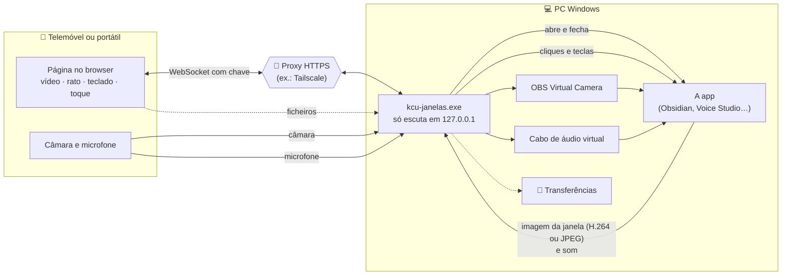
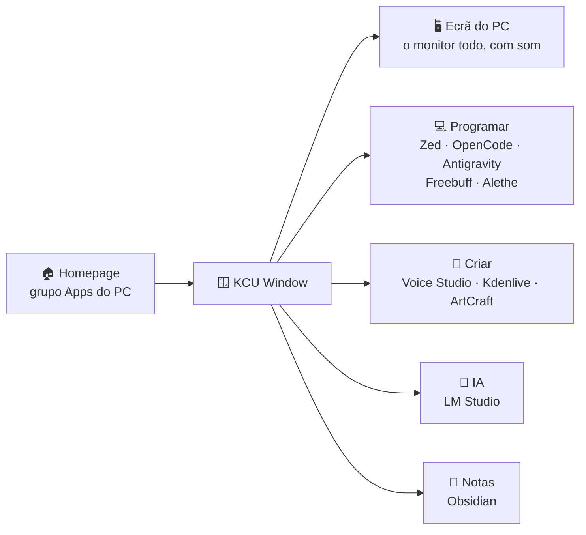

# KCU Window

> **Isto é uma ideia, não um produto.** É a forma como nós abrimos as apps do nosso PC no telemóvel. Está aqui de graça para quem quiser pegar e adaptar ao seu. Sem suporte e sem garantias.
>
> *This is an idea, not a product: how we do it at home, free for anyone to take and adapt. No support, no warranty.*

Abre **uma app do teu PC Windows no browser**, sem ambiente de trabalho remoto: a página mostra só a janela dessa app, e tu usas a app com rato, teclado ou toque, do telemóvel ou de outro computador.

*Open **a single Windows app in the browser**, without a full remote desktop: the page streams only that app's window and sends mouse, keyboard and touch back to it. (Interface in Portuguese.)*

## Como funciona



Cada página mostra **uma** app. Fechas o separador e a app fecha sozinha passados uns segundos.

## Como o usamos

Na nossa [página inicial](https://github.com/KCUServices/kcu-stack/blob/main/docs/apps.md) há um grupo "Apps do PC" com um cartão por app. Um toque no telemóvel e a app abre no PC de trabalho e aparece no ecrã do telemóvel.



- **[Zed](https://zed.dev), [OpenCode](https://opencode.ai), [Antigravity](https://antigravity.google), [Freebuff](https://github.com/CodebuffAI/freebuff) e [Alethe](https://github.com/Kc1t/alethe-agents):** programar e falar com agentes a partir do sofá.
- **[Voice Studio](https://github.com/debpalash/VoiceStudio), [Kdenlive](https://kdenlive.org) e [ArtCraft](https://github.com/storytold/artcraft):** vozes, edição e imagem com IA.
- **[LM Studio](https://lmstudio.ai):** experimentar modelos locais.
- **[Obsidian](https://obsidian.md):** as notas.
- **Ecrã do PC (`/?app=ecra`):** o monitor principal inteiro, quando é preciso mais do que uma app. Fica ao lado do [Chrome Remote Desktop](https://remotedesktop.google.com), que usamos só quando é mesmo preciso.

## O que faz

- **Uma app por página.** Cada app tem o seu endereço (`/?app=obsidian`). Podes ter várias abertas ao mesmo tempo, e cada página mostra sempre a sua app, mesmo quando outra está à frente no PC.
- **Abre e fecha a app sozinho.** Ao abrir a página, a app arranca no PC (maximizada). Ao fechar o separador, a app fecha passados uns segundos.
- **Vídeo fluido.** Com uma placa NVIDIA e o `ffmpeg`, a imagem vai em H.264 (até 60 FPS), descodificada no browser com WebCodecs. Sem isso, usa JPEG.
- **Feito para telemóvel também.** Um toque é um clique, um toque longo é o botão direito, e a pinça com dois dedos aproxima a imagem (até 6×). Tem um botão para teclado e outro para colar texto.
- **Ecrã inteiro.** `/?app=ecra` mostra o monitor principal todo (com som de todo o PC), em vez de uma app. Não abre nem fecha nada. `"ecra": false` na config desliga-o.
- **Ficheiros.** Arrasta ficheiros para cima da página (ou usa o botão Ficheiros → Enviar) e ficam nas Transferências do PC. No mesmo painel aparecem os ficheiros das Transferências e do Ambiente de trabalho do PC; toca num para o descarregar. A chave vai num cabeçalho, e cada descarga usa uma senha de uso único que dura 2 minutos.
- **Câmara do aparelho na app.** Com o [OBS Studio](https://obsproject.com) instalado no PC (não precisa de estar aberto), o botão da câmara manda a câmara do telemóvel/portátil para a "OBS Virtual Camera": na app (Chrome, Teams, Zoom, Discord…) escolhe essa webcam. Liga a câmara na página **antes** de a escolher na app. Toca na pré-visualização para trocar entre a câmara da frente e a de trás. `"camara": false` na config esconde o botão.
- **Página personalizável.** A página mostra o ícone real da app e um contador de FPS. Há um painel lateral para mudar a cor, o fundo, o ajuste da janela e a qualidade. As escolhas ficam guardadas em cada aparelho.

## Requisitos

- Windows 10/11 (usa Windows Graphics Capture e `SendInput`).
- [Rust](https://rustup.rs) para compilar.
- Opcional: [ffmpeg](https://ffmpeg.org) com `h264_nvenc` (placa NVIDIA) para o vídeo H.264.
- Um proxy HTTPS à frente, por exemplo o [Tailscale](https://tailscale.com) (`tailscale serve`). O programa só escuta em `127.0.0.1`.

## Instalar

O programa chama-se `kcu-janelas.exe` (o nome original, em português).

```powershell
git clone https://github.com/KCUServices/kcu-window
cd kcu-window
cargo build --release
```

1. Copia `target\release\kcu-janelas.exe` para uma pasta, por exemplo `C:\kcu-janelas\`.
2. Copia `kcu-janelas.exemplo.json` para essa pasta com o nome `kcu-janelas.json` e edita-o (ver abaixo).
3. (Opcional) Tira os ícones das apps: `powershell -File extrair-icones.ps1 -Config C:\kcu-janelas\kcu-janelas.json`
4. Põe-no a arrancar **dentro da tua sessão do Windows**, com uma tarefa agendada do tipo *Interactive*. Se correr como serviço, ou lançado por SSH, as apps abrem sem janela.

   ```powershell
   $a = New-ScheduledTaskAction -Execute 'C:\kcu-janelas\kcu-janelas.exe' -WorkingDirectory 'C:\kcu-janelas'
   $t = New-ScheduledTaskTrigger -AtLogOn -User $env:USERNAME
   $p = New-ScheduledTaskPrincipal -UserId $env:USERNAME -LogonType Interactive
   Register-ScheduledTask -TaskName 'KCU-Janelas' -Action $a -Trigger $t -Principal $p
   Start-ScheduledTask 'KCU-Janelas'
   ```
5. Abre o HTTPS, por exemplo com Tailscale: `tailscale serve --bg --https=3095 http://127.0.0.1:3095`
6. Abre `https://<o-teu-pc>:3095/?app=obsidian#t=<a-tua-chave>`. A chave vai depois do `#`, por isso nunca chega aos registos de servidores. A página guarda-a no separador.

## Configuração (`kcu-janelas.json`)

```json
{
  "porta": 3095,
  "chave": "troca-isto-por-uma-chave-longa-e-aleatoria",
  "permitidos": ["100.64.0.10"],
  "inicio": "https://o-teu-painel.exemplo",
  "ffmpeg": "C:\\ffmpeg\\bin\\ffmpeg.exe",
  "apps": {
    "obsidian": {
      "nome": "Obsidian",
      "exe": "C:\\Users\\<tu>\\AppData\\Local\\Programs\\Obsidian\\Obsidian.exe",
      "processo": "Obsidian.exe"
    }
  }
}
```

| Campo | O que é |
|---|---|
| `porta` | Porta local (só `127.0.0.1`). |
| `chave` | Senha de acesso, com pelo menos 16 caracteres. Em alternativa, `"segredos": {"ficheiro": "...", "campo": "..."}` lê-a de outro ficheiro JSON. |
| `permitidos` | IPs que podem entrar (o último do `X-Forwarded-For` que o proxy acrescenta). |
| `inicio` | Opcional: endereço do botão "Início" da página. |
| `ffmpeg` | Opcional: caminho do `ffmpeg.exe` com NVENC. Sem ele, o vídeo vai em JPEG. |
| `apps.<id>.processo` | Nome do processo (`Obsidian.exe`) ou caminho completo, para distinguir programas com o mesmo nome. |
| `apps.<id>.fechar` | `false` para nunca fechar a app ao sair da página (por exemplo, apps com terminais a trabalhar). |

A config fica ao lado do `.exe`, ou no caminho da variável de ambiente `KCU_JANELAS_CONFIG`. O registo (`kcu-janelas.log`) e os ícones (`kcu-janelas-icones\<id>.png`) ficam na mesma pasta da config.

## Segurança

- Só escuta em `127.0.0.1`. Quem chega de fora passa pelo teu proxy HTTPS, tem de estar em `permitidos` e tem de saber a `chave`.
- Quem entra controla a app como se estivesse sentado ao PC. Usa uma chave forte e não abras isto à internet aberta: prefere uma rede privada como o Tailscale.

## Notas

- Apps feitas em Electron ou WebView2 arrancam com opções que as impedem de parar de desenhar quando ficam tapadas por outra janela.
- O teclado e o rato chegam à app trazendo a janela dela para a frente. Com duas pessoas a usar apps diferentes ao mesmo tempo, as duas disputam a janela da frente.

## Episódios

A série no YouTube mostra a ferramenta a ser usada e melhorada sem cortes. Cada episódio tem uma versão do código (`ep01`, `ep02`…) para veres exatamente o que apareceu no vídeo.

| Ep. | Vídeo | Código | O que mudou |
|---|---|---|---|
| 00 | *em breve* | [ep00](../../tree/ep00) | Primeira versão pública |

O que mudou em cada versão está no [CHANGELOG](CHANGELOG.md).

## FAQ

**Funciona em Mac ou Linux?**
Não. O PC que partilha a app tem de ser Windows 10/11. Do lado de quem vê, serve qualquer browser moderno (telemóvel incluído).

**Preciso de placa NVIDIA?**
Não. Sem ela o vídeo vai em JPEG: funciona, mas com menos fluidez.

**Posso abrir isto à internet?**
Não deves. Usa uma rede privada como o Tailscale. Quem entra controla a app como se estivesse sentado ao PC.

**A app abre sem janela.**
O programa está a correr fora da tua sessão do Windows (como serviço ou por SSH). Usa a tarefa agendada *Interactive* do passo 4.

**A câmara não aparece na app.**
Liga a câmara na página **antes** de escolheres a "OBS Virtual Camera" na app.

**Tenho uma ideia ou uma pergunta.**
Vai às [Discussions](https://github.com/orgs/KCUServices/discussions). As ideias que entram aparecem no CHANGELOG com o teu nome.

## Mais da KCU Services

Outros projetos e produtos em [github.com/KCUServices](https://github.com/KCUServices).

## Licença

[PolyForm Noncommercial 1.0.0](LICENSE): podes usar, estudar, alterar e partilhar **para uso pessoal e sem fins comerciais**. Vender, revender ou usar isto num negócio precisa de autorização: fala connosco no Instagram [@kcu.services](https://www.instagram.com/kcu.services).

*Free for personal, noncommercial use. Selling or commercial use requires permission from KCU Services.*

**Marca e imagens:** o nome KCU, os logótipos e as imagens dos produtos são da KCU Services, com todos os direitos reservados. A licença cobre só o código e a documentação. Ver [MARCA.md](MARCA.md).
